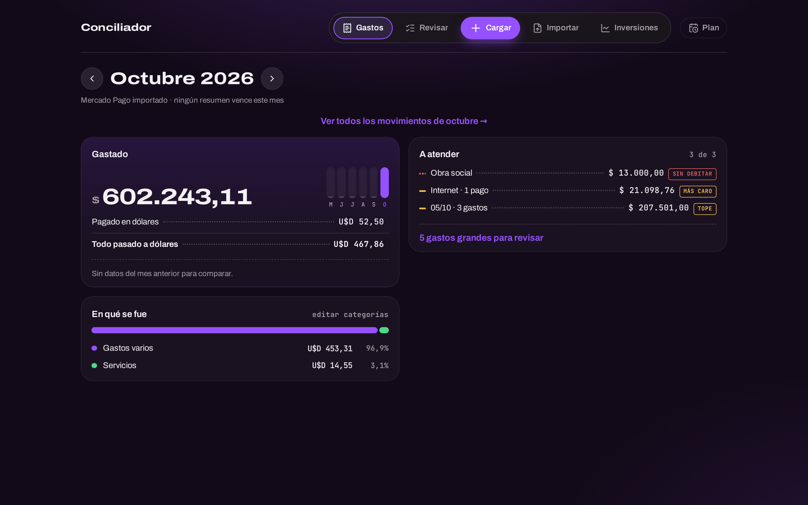
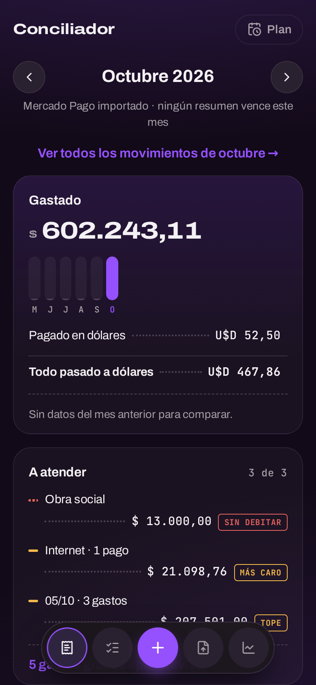
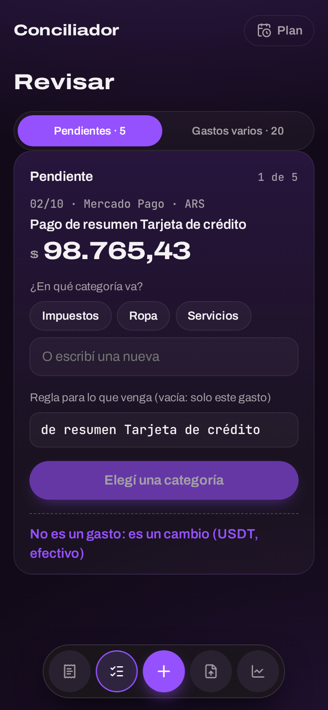
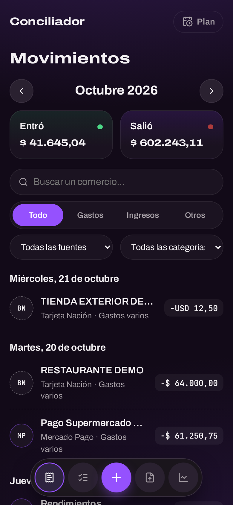
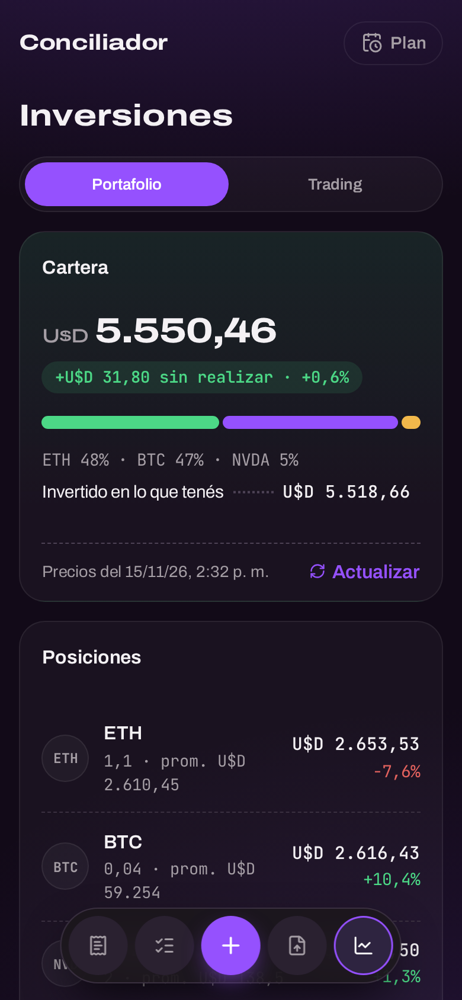

# Conciliador

Cruza lo que realmente gasté contra lo que tenía planeado, en pesos y en dólares al oficial del día, y sigue mis inversiones en el mismo lugar.

Lee los resúmenes en PDF que ya descargo (Mercado Pago y tarjetas Comafi y Banco Nación), los verifica al centavo contra sus propios totales y nunca duplica un movimiento. Corre en mi máquina: los datos reales no salen de ahí.

<p align="center">
  
</p>

<table>
  <tr>
    <td></td>
    <td></td>
    <td></td>
    <td></td>
  </tr>
  <tr>
    <td align="center">Gastos</td>
    <td align="center">Revisar</td>
    <td align="center">Movimientos</td>
    <td align="center">Inversiones</td>
  </tr>
</table>

Las capturas usan la demo: datos inventados con el mismo formato que los reales.

## Qué hace

- **Gastos del mes.** Totales en pesos y en dólares, y lo que hay que atender: un fijo que no se debitó o vino más caro, una cuota que falta, un día que pasó el tope, un resumen de tarjeta sin pagar. Se puede ir a meses anteriores.
- **Importar.** Lee los PDF de Mercado Pago, Comafi y Nación (este último con contraseña). Cada movimiento se reconoce por su número de operación, así que importar dos veces el mismo resumen no duplica nada.
- **Revisar y categorizar.** Los gastos grandes sin anticipar piden confirmación. Los demás se categorizan con reglas ("todo lo que diga *Farmacia* va a Salud") que se crean desde la app.
- **Plan.** Los gastos fijos y las cuotas esperadas, editables desde la app.
- **Movimientos.** Todo lo que entró y salió, con buscador y filtros, para corregir la categoría de cualquiera.
- **Inversiones.** Cartera con precio promedio, ganancia realizada y no realizada, precios de Binance y Yahoo Finance, y acciones en otras monedas convertidas con el cambio del día. Las operaciones se pueden cargar desde **capturas de pantalla**: Claude las lee y la app muestra lo que entendió para revisarlo antes de guardar.

## Cómo está hecho

| | |
|---|---|
| Backend | Python 3.12, FastAPI, SQLAlchemy 2, Alembic, SQLite, pdfplumber |
| Front | React 19, TypeScript, Vite, con los tipos generados desde los esquemas de la API |
| IA | API de Claude (Anthropic) con salida estructurada, para leer capturas |
| Pruebas | pytest, Vitest y Playwright para revisar el diseño en celular y computadora |

Algunas decisiones:

- **La plata nunca pasa por `float`.** Los montos se guardan en centavos enteros; las inversiones, con `Decimal`, porque una cantidad como 0,03049235 BTC no entra en centavos.
- **Un solo módulo toca la base.** Todo pasa por `base.py`, y un test falla si otro módulo usa SQLAlchemy. Los comandos de terminal y la API usan las mismas funciones.
- **Las consultas del reporte son SQL** (`conciliador/consultas/`), legibles y probadas contra la base.
- **Migraciones con respaldo.** Una base desactualizada no arranca; `migrar` la actualiza y antes guarda una copia.
- **El front no adivina la forma de los datos.** Los esquemas de Pydantic generan el OpenAPI, y de ahí salen los tipos de TypeScript.
- **La IA propone, la persona confirma.** Lo leído de una captura nunca se guarda solo, y una misma operación no se carga dos veces.
- **Nada expuesto.** El servidor escucha solo en `127.0.0.1`; las claves viven en `.env` y nunca llegan a la página. Los datos reales y la base están fuera del repo.

## Probarlo con la demo

Hace falta Python 3.12 y Node 22 o más nuevo.

```bash
python -m venv .venv
.venv/bin/pip install -e ".[dev]"
(cd web && npm ci && npm run build)

CONCILIADOR_DB=demo.db .venv/bin/python -m conciliador importar demo
CONCILIADOR_DB=demo.db .venv/bin/python -m conciliador web
```

Y abrir <http://127.0.0.1:8000>. Los datos de la demo son de octubre y noviembre de 2026: las tarjetas van a mes vencido, así que sus compras de octubre se ven en noviembre.

Para leer capturas de inversiones hace falta una clave de Anthropic en `.env`:

```
ANTHROPIC_API_KEY=...
```

## Pruebas

```bash
.venv/bin/python -m pytest
(cd web && npm test)
```

## Estructura

```
conciliador/
  lectores/      un lector por fuente de PDF
  consultas/     el SQL del reporte
  migraciones/   Alembic
  api.py         FastAPI
  base.py        lo único que toca la base
  capturas.py    lectura de capturas con Claude
demo/            PDFs y plan inventados, y los scripts que los generan
web/             la página: React y TypeScript
tests/
```

## Lo que sigue

Un chat con un agente propio para dictarle un gasto o pasarle cualquier cosa (una captura, un PDF, una tenencia) y que la cargue, con la confirmación de lo importante en la API y no en el modelo.
